<div align="center">

<a href="https://github.com/muzammil-kj">
  
</a>

<br/><br/>

[](https://3d-portfolio-omega-jet.vercel.app/)
[](https://www.linkedin.com/in/muzammil-khan-87b185267/)
[](mailto:muzammilkhan.kj@gmail.com)
[](https://guardloop-iota.vercel.app)

</div>

---

## 🧠 About me

I'm an **AI Engineer** and Information Technology graduate from NUML, Islamabad. I build **LLM-powered applications**, **RAG pipelines** and **automation systems** that have to behave reliably in production. What I care about most is the part that's easy to skip: deciding when an AI system should act on its own, and when it should hand the decision to a person.

- 🔭 **Now:** building **[Guardloop](https://github.com/muzammil-kj/guardloop)**, an open-source guardrail and observability layer for AI agents (FastAPI, Supabase, Next.js, Gemini)
- 🧬 **Recently:** AI/LLM/SLM Engineer Intern at **CarbonRepro**, on a multi-agent healthcare platform with RAG and vector search
- ⚙️ **Automation:** n8n workflows for email triage, social publishing and recruitment pipelines
- 🎯 **Open to:** AI Engineer, LLM Engineer and AI Automation roles
- 💬 **Ask me about:** RAG design, agent safety and human-in-the-loop systems, n8n
- 🥾 **Outside code:** hiking, trekking, and tech community meetups


---

## ⚙️ Tech stack

<div align="center">


<br/><br/>


</div>

---

## 🛡️ Featured project: Guardloop

**Guardrails and observability for AI agents.** Agents report each decision to Guardloop. Uncertain decisions go to a human reviewer, a budget cap stops runaway spend, personal data is masked before storage, and every action is recorded.

`FastAPI` · `Supabase (Postgres, Auth, Realtime, RLS)` · `Next.js` · `Gemini (LLM judge)` · `GitHub Actions` · `Docker`

```
Agent ──► /ingest ──► confidence & policy check ──► approved ──► LLM judge samples it
                              │                                        │
                              ▼                                        ▼
                     human review queue  ◄──────────────  judge disagrees
```

- 👥 Human review queue with roles, owners and deadlines, plus overdue alerts to Discord and Slack
- 🧪 LLM judge that re-checks a sample of auto-approved decisions, without seeing the agent's own confidence
- 🔁 Idempotent ingestion, a daily budget circuit breaker, and PII masking before storage
- 📦 Python SDK, CI on every pull request, and a 219-test backend suite

[](https://guardloop-iota.vercel.app) [](https://github.com/muzammil-kj/guardloop)

---

## 🩺 Featured project: LifeSync

**AI-driven mental wellness platform.** Final-year project at NUML, Islamabad.

`Python` · `ReactJS` · `Node.js/Express` · `MongoDB/Firebase` · `NLP` · `OpenCV`

- 🤖 NLP chatbot for mental health support, with real-time facial emotion detection that fills in mood tracking
- 📓 Sentiment analysis on journal entries, with weekly progress reports and email affirmations
- 🔐 Time Capsule module with an NSFW content filter and steganography for sensitive files

[](https://github.com/muzammil-kj/LifeSync-My-Final-Year-Project)

---

## ❤️ Featured project: Cardiovascular disease prediction

`Python` · `Pandas` · `NumPy` · `Scikit-learn` · `Matplotlib` · `Seaborn`

- 📊 Binary classifier on a 303-patient clinical dataset (13 features)
- ⚖️ Benchmarked KNN, Random Forest and Logistic Regression; tuned with `GridSearchCV`
- 🎯 **82.8% cross-validated accuracy (7-fold)**, with precision 81%, recall 89% and F1 85%
- 🔍 Feature analysis: `sex` and `thal` as negative predictors, `cp` (chest pain type) as the strongest positive predictor

[](https://github.com/muzammil-kj/cardio_project)

---

## 💼 Experience

### 🏆 Automation Engineer, DevSynt (Rise Summer Internship 2026)
**1st place, Cohort 1** · Jul 2026 – Sep 2026 · Remote/Hybrid

<details open>
<summary><b>Six applied AI projects</b></summary>

1. **AI email filtering:** Gmail, Gemini importance classification, Discord and Telegram alerts, auto-archiving of low-priority mail, with error handling and an audit log
2. **AutoGram Engine:** Google Drive, SHA-256 deduplication, Supabase storage, Gemini Vision captions, published to Instagram through the Graph API
3. **AI hiring pipeline:** email and Google Forms intake merged into one schema, LLM ATS scoring (Strong / Average / Weak), with a human making the final decision
4. **Data cleaning and enrichment:** 1,250-record Kaggle dataset, documented data issues, careful duplicate handling and derived fields, loaded to Supabase
5. **RAG document Q&amp;A:** upload, chunking, embeddings, vector search, and cited answers with "not found" guardrails
6. **AI email triage and RAG assistant:** intent and priority classification, RAG answers for general questions, and escalation of sensitive messages to people

</details>

### 🧬 AI/LLM/SLM Engineer Intern, CarbonRepro
Remote · Jun 2026 – Sep 2026

- Delivered three patient-facing AI agents end to end on a multi-agent healthcare platform (FastAPI, Prisma, PostgreSQL, Next.js)
- Built RAG pipelines: document ingestion, embeddings, Qdrant retrieval and Cohere/Gemini generation, returning source-cited answers
- Designed database schemas and migrations, background jobs, and alerting for health monitoring
- Built dashboards with Recharts and Clerk authentication, working through Git feature branches and pull requests

### 📊 Data Analytics Intern, Elevvo Pathways
Aug 2025 – Sep 2025 · Virtual

- Cleaned Kaggle and retail datasets with Pandas, ran exploratory analysis, and prepared Scikit-learn train/test pipelines

### 🐍 Python Development Intern, CodeAlpha
Jul 2024 – Oct 2024 · Virtual

- Built Python applications and scripts for real-world programming problems, following professional coding standards

---

## 🎓 Education

**Bachelor of Information Technology**, National University of Modern Languages (NUML), Islamabad
Feb 2022 – Jan 2026 · **CGPA 3.56 / 4.0**

**🗣️ English:** IELTS 7.5

---

## 📜 Certifications and courses

<table>
<tr>
<td>

**DigiSkills.pk**
- Artificial Intelligence using Python
- Data Analytics and Business Intelligence
- Full Stack Development with MERN
- Cloud Computing
- Freelancing
- SEO (Search Engine Optimization)

</td>
<td>

**Other**
- Machine Learning, AI &amp; Data Science, eHunar
- Automation Engineer, DevSynt Rise Summer Internship 2026 (1st place)

</td>
</tr>
</table>

---

## 📊 GitHub stats

<div align="center">




<br/>


</div>

---

## 📫 Let's connect

<div align="center">

[](mailto:muzammilkhan.kj@gmail.com)
[](https://www.linkedin.com/in/muzammil-khan-87b185267/)
[](https://3d-portfolio-omega-jet.vercel.app/)
[](https://github.com/muzammil-kj)

<br/>

<i>Thanks for stopping by. Let's build something intelligent together.</i>

</div>


